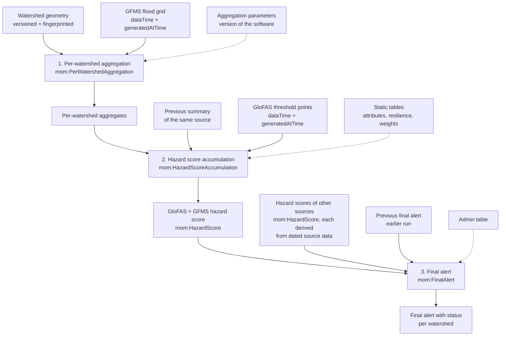
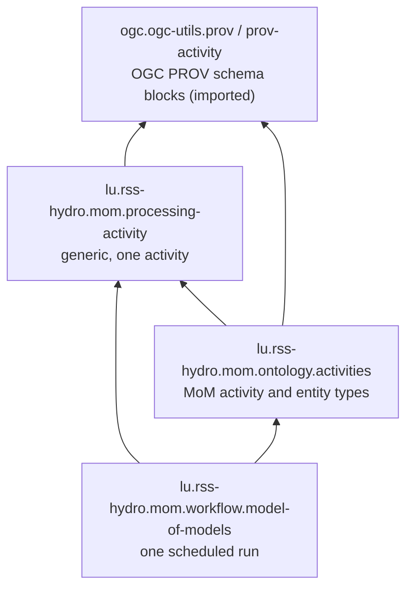
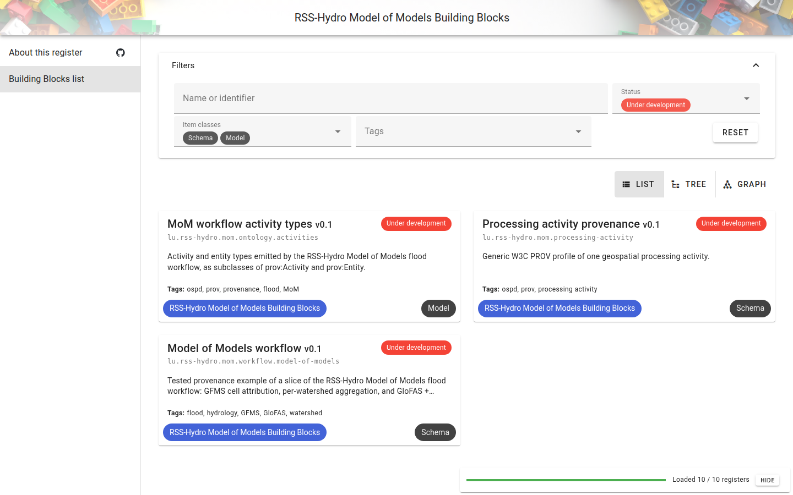
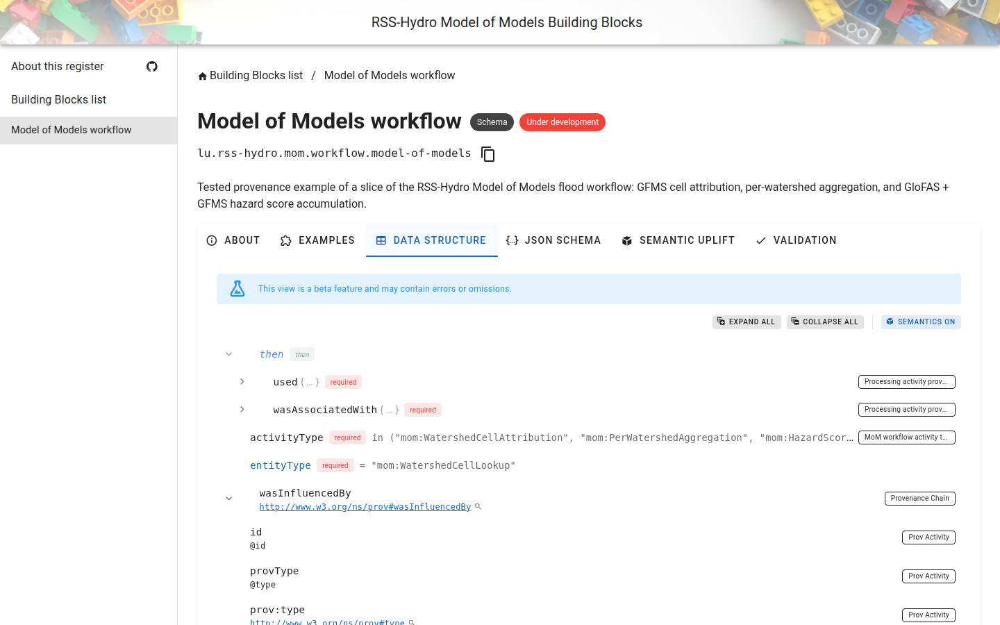
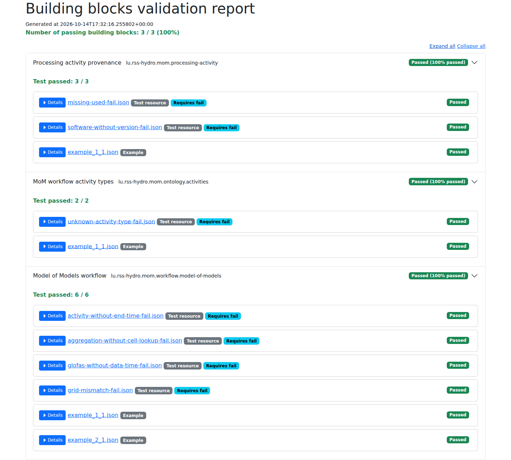

# OSPD 2026 D001 — RSS-Hydro contribution text

Contribution of RSS-Hydro to the *OGC Open Science Persistent Demonstrator 2026 Report*
([D001](http://ospd-2026-36227f.pages.ogc.org/documents/D001/document.html)), in the role of
**Workflow Profiler (D100)**.

This page holds the text, schemas, listings and figures to be inserted into D001:

| Part | Goes into D001 |
|---|---|
| [1. Section 2.3.1](#1-text-for-section-231) | replaces the one-sentence RSS-Hydro entry in 2.3.1 *Workflow profiling and provenance examples* |
| [2. Annex H](#2-annex-h-informative-rss-hydro-contribution-to-the-ogc-open-science-persistent-demonstrator-2026) | a new informative annex, in the form used by the 52°North (Annex C) and Lampata (Annex G) annexes |

The annex letter is a placeholder; it is assigned by the editor. Figures and listings are numbered
within the annex.

Material referenced from both parts:

| Resource | Location |
|---|---|
| Building blocks repository | https://github.com/KatKatKateryna/ospd2026_bblocks-template |
| Published register (viewer) | https://katkatkateryna.github.io/ospd2026_bblocks-template/ |
| Register metadata | https://katkatkateryna.github.io/ospd2026_bblocks-template/build/register.json |
| Validation report | https://katkatkateryna.github.io/ospd2026_bblocks-template/build/tests/report.html |
| Same blocks for the shared register | `_sources/rss-hydro/` on branch `ospd_rss-hydro` of a fork of https://github.com/ogcincubator/bblocks-openscience |
| Profiled workflow | MoMProduction, the RSS-Hydro Model of Models flood chain |

---

## 1. Text for Section 2.3.1

Current text in the draft:

> RSS-Hydro produced a draft generic provenance Building Block derived from the base utility block,
> with the design intent of tightening constraints the base block leaves open.

Proposed replacement:

> RSS-Hydro profiled the Model of Models (MoM) flood workflow, an unattended chain whose jobs run on
> a fixed schedule and combine third-party hydrological and meteorological products into a
> per-watershed hazard score and alert level. The contribution is three Building Blocks: a generic
> processing-activity profile derived from the base PROV utility block, which tightens what that
> block leaves open by requiring an activity type, a name, start and end times, inputs, outputs and
> an association, and by requiring every inline input to carry either a generation time or a version
> and every inline software agent to carry a version; a small activity-type vocabulary whose three
> geoprocessing terms are candidate entries for the process-type register; and a workflow block that
> profiles one scheduled run from the GFMS and GloFAS branch of the chain to the final alert that
> combines the hazard scores of all sources, with the links between its activities constrained in
> JSON Schema and SHACL.
>
> The stated design target was the reproducibility of a scheduled run rather than the description of
> a single interactive execution. A record therefore separates the time the input data refers to
> from the time the input file was written, traces each model's hazard score in the published alert
> to the dated data it was computed from, and binds parameters and static tables to the software
> version they ship with. Two failure modes of an operational chain become validation failures rather
> than silently wrong numbers: an input that is stale or truncated, and an alert combining a model
> score that cannot be traced to dated source data. Eleven tests are published with the register, seven of them negative
> tests that assert the constraints reject malformed records, and the same blocks were prepared for
> the shared open-science register. The Participant also reported that validation has to be runnable
> offline for a profile to be usable inside a scheduled job, and supplied a pinned offline validator
> that applies the published JSON Schema, JSON-LD uplift and SHACL checks with no network access.

---

## 2. Annex H (informative) RSS-Hydro Contribution to the OGC Open Science Persistent Demonstrator 2026

Deliverable(s): D100 — Workflow Profiler; D001.

RSS-Hydro participated in the OGC Open Science Persistent Demonstrator 2026 as a Workflow
Profiler (D100), developing a profile of W3C PROV for a flood prediction automated pipeline.

### H.1 Contribution overview

Built: three Building Blocks (prefix `lu.rss-hydro.mom.`) profiling one scheduled run of the Model
of Models (MoM) flood chain, published as a standalone register and mirrored to the shared
open-science register, plus an offline validator.

Aim: make a run reproducible and make broken inputs fail validation — a stale or truncated upstream
file, a model score with no dated source, a job that died halfway. Unattended, these otherwise yield
plausible-looking output.

#### H.1.1 Profiled workflow

MoM ingests several independent products, each on its own schedule derived from the publication
window of its provider — a global forecast model published shortly after each six-hourly cycle, a
daily threshold-point forecast published mid-morning, and daily satellite flood products available
the following night. Each job downloads the product, aggregates it per watershed, accumulates the
MoM hazard score with the previous state of the chain, and publishes alerts.

The slice profiled for OSPD 2026 follows the GFMS and GloFAS branch of that chain to the final
alert, and contains the three operations that recur, in some form, across the chain: aggregate a
gridded product per zone, compose and classify an index, then fuse the indices of all sources into
one alert.



*Listing H.1 — The profiled slice: three activities, their inputs (dashed: configuration shipped with
the software) and their outputs. All three are `dcterms:isPartOf` one `mom:WorkflowRun`.*

| Activity | Activity type | Uses | Generates |
|---|---|---|---|
| Per-watershed aggregation | `mom:PerWatershedAggregation` | source file, watershed geometry, parameters | per-watershed aggregates |
| Hazard score accumulation | `mom:HazardScoreAccumulation` | aggregates, previous summary, GloFAS file, static tables, parameters | summary with recalculated duration, GloFAS + GFMS hazard score, cleaned attributes |
| Final alert | `mom:FinalAlert` | GloFAS + GFMS hazard score, hazard scores of any other sources, previous final alert, admin table | final alert with status per watershed |

The final alert is the step that reads across models and across runs. Each model's score refers to
its own data time — in the example, one source's score to the previous six-hourly cycle and
another's to the day before — and the record links each score to the dated data it was derived
from. The previous final alert points at the earlier run that produced it; on a first run there is
none and every watershed is New. This is what makes a published alert traceable across sources and
scheduled runs rather than only within one run.

#### H.1.2 Architecture

The profile is layered, each layer a Building Block that depends only on the one below it:



*Listing H.2 — Dependencies between the Building Blocks (`dependsOn` in each `bblock.json`).*

| Building block | Identifier | Item class | Artefacts | Role |
|---|---|---|---|---|
| Processing activity provenance (generic) | `lu.rss-hydro.mom.processing-activity` | schema | JSON Schema, JSON-LD context, 2 negative tests | tightens the base PROV activity; domain-neutral |
| MoM workflow activity types | `lu.rss-hydro.mom.ontology.activities` | model | OWL/SKOS ontology (Turtle), JSON-LD context, JSON Schema, 1 negative test | declares the `mom:` terms and checks that a typed activity is a valid processing activity |
| Model of Models workflow | `lu.rss-hydro.mom.workflow.model-of-models` | schema | JSON Schema, SHACL rules, JSON-LD context, examples, 4 negative tests | constrains one run as a whole: entries, links between activities, dated derivation of model scores |



*Figure H.1 — The three Building Blocks in the published register.*

Around the blocks:

- **Build and publication.** The OGC Building Blocks postprocessor runs in CI on each push, imports
  the main OGC register and the OGC PROV schema register, resolves `bblocks://` references, performs
  the JSON-LD uplift, runs all checks and publishes the register, viewer and validation report to
  GitHub Pages.
- **Offline validator.** `local-build/` runs the same postprocessor image, pinned by digest, against
  any record with networking disabled and all imports served from a pre-fetched cache (H.4).
- **Shared register.** The same blocks are mirrored under `_sources/rss-hydro/` of a fork of the
  shared open-science register.

#### H.1.3 Design choices

- **Profile the OGC PROV blocks rather than define a model.** Reusing `ogc.ogc-utils.prov-activity`
  keeps records readable by any PROV consumer; the profile only adds constraints and terms.
- **Generic and workflow blocks kept separate.** Constraints that hold for any processing activity
  (end time, versioned software, dated inputs) sit in a domain-neutral block reusable outside MoM;
  only MoM-specific rules sit in the workflow block.
- **Vocabulary as its own model block.** Activity types are an ontology, not schema enums, so they
  can be moved to the process-type register without changing the schemas that use them.
- **JSON Schema plus SHACL.** Per-entry checks in JSON Schema, graph-level checks in SHACL (H.5).
- **Offline validation, not CI only.** Needed for the profile to be applied by the scheduled job
  itself.

### H.2 Provenance implementation — Workflow Profilers and OGC API Processes Profilers

**Building block built against.** The profile reuses the OGC PROV schema Building Blocks
(`ogc.ogc-utils.prov`, `ogc.ogc-utils.prov-activity`) and refines them; no parallel model is
defined.

**Generic processing activity.** `lu.rss-hydro.mom.processing-activity` is domain-neutral and
constrains one activity. It is reusable outside MoM, and is what the OSPD base block would look like
with its optional parts made mandatory.

```yaml
allOf:
  - $ref: bblocks://ogc.ogc-utils.prov-activity
required: [id, activityType, name, startedAtTime, endedAtTime, used, generated, wasAssociatedWith]
$defs:
  datedOrVersioned:   # an inline entity states generatedAtTime or dcterms:hasVersion
  softwareVersioned:  # an inline software agent states dcterms:hasVersion
```

*Listing H.3 — Constraints tightened over the base block (abridged from `schema.yaml`).*

**Activity and entity types.** `lu.rss-hydro.mom.ontology.activities` declares the MoM terms as
subclasses of `prov:Activity` and `prov:Entity` under `mom:` (`https://rss-hydro.lu/ns/mom/`),
together with the properties the profile needs (`mom:dataType`, `mom:dataTime`,
`mom:watershedFingerprint`) and the SKOS scheme of alert levels the hazard score accumulation assigns. Its schema
checks that any record carrying one of these activity types is a valid processing activity.

**One workflow run.** `lu.rss-hydro.mom.workflow.model-of-models` constrains a whole PROV document:
three MoM activities, each linked to a single `mom:WorkflowRun` activity, plus the entities
and agents they refer to.

```yaml
- if: {$ref: '#/$defs/isHazardScore'}
  then:
    required: [mom:dataType, mom:dataTime, generatedAtTime, wasDerivedFrom]
- if: {required: [mom:dataType]}
  then:
    required: [dcterms:format]
    anyOf:
      - required: [dcterms:hasVersion]          # configuration shipped with the software
      - required: [generatedAtTime, mom:dataTime]   # data and scores: both times required
```

*Listing H.4 — Per-entry rules that make a stale or unattributable input a validation failure
(abridged from `schema.yaml`).*

Relationships between activities cannot be expressed in JSON Schema and are stated as SHACL shapes
applied after the JSON-LD uplift.

```turtle
<#hazardScoreDerivedFromDatedData> a sh:NodeShape ;
    sh:targetClass mom:HazardScore ;
    sh:sparql [ sh:message "Hazard score must derive from model data with a mom:dataTime" ; ... ] .
```

*Listing H.5 — One of three SHACL rules: hazard accumulation must use the output of an aggregation,
the final alert must use a hazard score of a hazard accumulation, and every hazard score must derive
from model data with a data time (abridged from `rules.shacl`).*

A record of one run is a JSON-LD array of agents, entities and activities. The excerpt below shows
the parts that carry the reproducibility information: a third-party input with both of its times,
the hazard score derived from it, and the final alert that combined the scores of all sources.

```json
{ "id": "run:source-2-data", "entityType": "prov:Entity",
  "mom:dataType": "Source 2", "dcterms:format": "GeoTIFF",
  "mom:dataTime": "2026-02-28T00:00:00Z", "generatedAtTime": "2026-03-01T02:10:44Z",
  "wasAttributedTo": "run:provider-1" },
{ "id": "run:source-2-score", "entityType": "mom:HazardScore",
  "mom:dataType": "Source 2", "dcterms:format": "text/csv",
  "mom:dataTime": "2026-02-28T00:00:00Z", "generatedAtTime": "2026-03-01T04:12:30Z",
  "wasDerivedFrom": "run:source-2-data" },
{ "id": "run:final-alert", "activityType": "mom:FinalAlert",
  "startedAtTime": "2026-03-02T01:12:48Z", "endedAtTime": "2026-03-02T01:12:52Z",
  "used": ["run:final-attributes", "run:source-1-score", "run:source-2-score",
           "run:final-alert-prev", "run:admin-centroids"],
  "generated": "run:final-alert-output",
  "wasAssociatedWith": ["run:mom", "run:rss-hydro", "run:server"],
  "dcterms:isPartOf": "run:workflow-run" }
```

*Listing H.6 — Excerpt of the published example record (identifiers and values illustrative).*



*Figure H.2 — The workflow block in the register viewer: required properties, the enumeration of MoM
activity types, and the imported PROV terms they refine.*

**Identifiers.** Each run has its own namespace, `run:` = `https://example.org/mom/run/<YYYYMMDDHH>/`,
keyed by the data cycle, and each activity, entity and agent is named within it (`run:aggregation`,
`run:gfms-bin`). Identifiers are therefore deterministic: emitting the same run twice yields the same
IRIs, which merge in RDF. Illustrative base pending production emission.

**Chain linking.** Within a run, a step's output is linked to the next step's input by identifier
(`generated` of one activity in `used` of the next), and every activity is `dcterms:isPartOf` the
`mom:WorkflowRun`. Across runs, a reused artefact (the previous final alert) points with `wasGeneratedBy` to
the full IRI of the activity in the earlier run that produced it. SHACL checks that the links hold.

**Where records live.** Currently as examples and tests of the workflow block, published with the
register. In production, one record per run beside the products (H.7).

**OGC API — Processes.** Not applicable; MoM is not exposed as an OGC API — Processes service.

### H.3 Process types and register contribution — all Participants

Three activity types are offered as candidate entries for the process-type register. They are stated
as subclasses of a common parent, `mom:Geoprocessing`, so that the register can place them under a
broader operation if one is adopted, and each is named after the generic operation rather than after
the MoM implementation.

| Term | Generic operation | Register note |
|---|---|---|
| `mom:PerWatershedAggregation` | zonal statistics | the aggregation function and the nodata handling are parameters, not separate types |
| `mom:HazardScoreAccumulation` | index composition and classification | composes weighted indicators and assigns a level from a published scheme |
| `mom:FinalAlert` | multi-source fusion and change detection | combines the indices of several sources and compares with the previous issue; the status (New, Continued, Upgraded, Downgraded) is an output, not a separate type |

Alongside them the profile contributes three supporting terms that proved necessary to describe a
scheduled chain and are offered for discussion rather than registration: `mom:WorkflowRun`, the
activity that groups one run; `mom:HazardScore`, the entity type for one source's score table, which
must be traceable to the dated data it was computed from; and `mom:AlertLevels`, a versioned SKOS scheme giving the minimum score of each alert
level, so that a published alert can be resolved back to the thresholds in force when it was issued.

Identifiers are currently in a vendor namespace and versioned `0.1` with status *under development*;
they are placeholders pending assignment of resolvable register identifiers.

### H.4 Validation evidence

All three blocks build and validate with the OGC Building Blocks postprocessor in CI, and the
published report shows 3 / 3 blocks passing, over eleven test records: four examples and seven
negative tests. A negative test is a record that is required to fail; it is how each constraint is
documented and kept honest.



*Figure H.3 — Published validation report, all blocks and tests passing
(`build/tests/report.html`).*

| Negative test | Constraint asserted |
|---|---|
| `missing-used-fail` | an activity must state its inputs |
| `software-without-version-fail` | an inline software agent must state its version |
| `unknown-activity-type-fail` | an activity typed only as `prov:Activity` is not a MoM activity |
| `activity-without-end-time-fail` | an activity that never ended is not a complete record |
| `final-alert-without-accumulated-score-fail` | a final alert must use a hazard score of the hazard accumulation |
| `hazard-score-without-dated-source-fail` | a model's hazard score must derive from data with a data time |
| `glofas-without-data-time-fail` | a third-party input must state the time its data refers to |

Validation can also be run away from CI. `local-build/validate.sh` applies the same three checks —
JSON Schema, JSON-LD uplift, SHACL — to any JSON record, inside a Docker image pinned by digest,
with networking disabled and all imported registers and schemas served from a pre-fetched cache. It
prints PASS or FAIL per record with the reason. This is what makes the profile usable from a
scheduled job: the run validates its own provenance before publishing, on a machine that may have no
route to the registers, and a failure is raised on the same path as a failed download.

The provenance records published with the blocks are representative of one production run, with
illustrative identifiers; emission of the records by the production code itself is future work
(H.7).

### H.5 Provenance encoding: choice and reasoning

The encoding is PROV in JSON-LD, with the constraints split between JSON Schema and SHACL.

RO-Crate and CWLProv were not used because MoM is not run by a workflow engine: it is a set of
scheduled Python jobs, so there is no engine-emitted provenance to convert, and the question of what
counts as a step is answered by the profile rather than by an executor. Writing PROV directly also
keeps the record small enough to produce inside each job.

JSON Schema was chosen for everything that can be checked on one entry — required fields, the two
times, formats, versions — because it is cheap, runs anywhere and gives an error at the point of
emission. SHACL was used only where a statement is about the graph: that hazard accumulation used
the output of an aggregation, that the final alert used an accumulated hazard score, and that every
hazard score derives from dated model data. Keeping the two separate also means a job that cannot run an RDF toolchain still
gets most of the checks.

JSON-LD rather than Turtle because the production code already writes JSON, and the uplift to RDF is
performed by the Building Block tooling.

### H.6 Findings and lessons learned

**The base block is permissive by design, and that is where profiling earns its place.** Records
that are valid against the generic PROV blocks can be useless for reproduction — an activity with no
end time, software with no version, an input with no time at all. Each of those is a negative test in
this profile. It would help contributors if the register stated, per block, which constraints a
profile is expected to tighten.

**A scheduled chain needs two times, and PROV offers one.** `generatedAtTime` says when the file was
written; it does not say what the data is about. Without a separate data time, a run that silently
reused the previous day's input is indistinguishable from a correct one, which is precisely the
failure an unattended chain must detect. The profile adds `mom:dataTime` and requires both on every
third-party input.

**A fused product is only as traceable as its least documented input.** The final alert combines
scores of several sources, each on its own schedule, so one alert mixes data times: in the example
one source's score refers to the previous cycle and another's to the day before. Unless
each score is linked to the data time it was computed from, a source that silently stopped updating
looks the same as a current one. The profile types each score as `mom:HazardScore` and SHACL
requires a derivation path to dated model data; a generic provenance model has no notion of this,
so a shared pattern for "inputs of a fused product and their data times" would be reusable well
beyond hydrology.

**Which provenance block to profile was not obvious.** Several PROV Building Blocks were available
across the initiative with overlapping scope, and the choice was made on inspection rather than on
guidance — the same ambiguity raised by another Participant and recorded as a risk.

**Validation that needs the network cannot be part of an operational job.** Pinning the postprocessor
image by digest and caching every imported register and schema was necessary before validation could
be considered for the scheduled runs.

**Constraining a document rather than a single object is awkward.** One run is an array of agents,
entities and activities, and expressing "three MoM activities, each part of one run" uses
`contains` / `minContains` with per-item conditionals. It validates correctly, but a failure reports
the document rather than the offending entry, which is poor feedback for an operator.

### H.7 Recommendations

- Record, per registered process type, what inputs and outputs it is expected to have, so a workflow
  profile can check a record against its declared type instead of restating the expectation.
- Add to the common provenance profile a property for the time data refers to, distinct from the time
  an artefact was produced. Scheduled and backfilled runs cannot be told apart without it.
- Make negative tests a convention for contributed profiles. Seven failing records communicated this
  profile's intent more precisely than its prose description.
- Keep profile validation runnable offline with pinned tooling, so that it can be executed by the
  workflow it describes rather than only in CI.
- Resolve process-type identifiers and their versioning before profiles are asked to depend on them;
  until then, profiles have to point at vendor namespaces, which is not reusable.

RSS-Hydro's next steps:

- Emit the provenance document from the production code — one record per scheduled run, written
  beside the products — and validate it in the job, so that a broken or stale source raises an alert
  through the existing path instead of being discovered in the numbers.
- Extend the profile to the activities of the remaining source branches, whose scores the final
  alert already uses, and to the publication step, and
  link consecutive runs through the artefacts they reuse, giving a provenance trail across the
  schedule rather than within one run.
- Re-point the activity types at register identifiers once assigned, and submit the alert-level
  scheme as an example of a run-time classification vocabulary that has to be versioned.
- Evaluate RO-Crate for packaging the products of a run alongside the record, now that the record
  itself is defined.

### H.8 References

- RSS-Hydro MoM Building Blocks — repository: https://github.com/KatKatKateryna/ospd2026_bblocks-template
- RSS-Hydro MoM Building Blocks — published register: https://katkatkateryna.github.io/ospd2026_bblocks-template/
- Validation report: https://katkatkateryna.github.io/ospd2026_bblocks-template/build/tests/report.html
- Open Science Workflows Building Blocks (shared register): https://github.com/ogcincubator/bblocks-openscience
- OGC PROV schema Building Blocks: https://ogcincubator.github.io/bblock-prov-schema/
- W3C PROV-O: https://www.w3.org/TR/prov-o/
- W3C SHACL: https://www.w3.org/TR/shacl/
